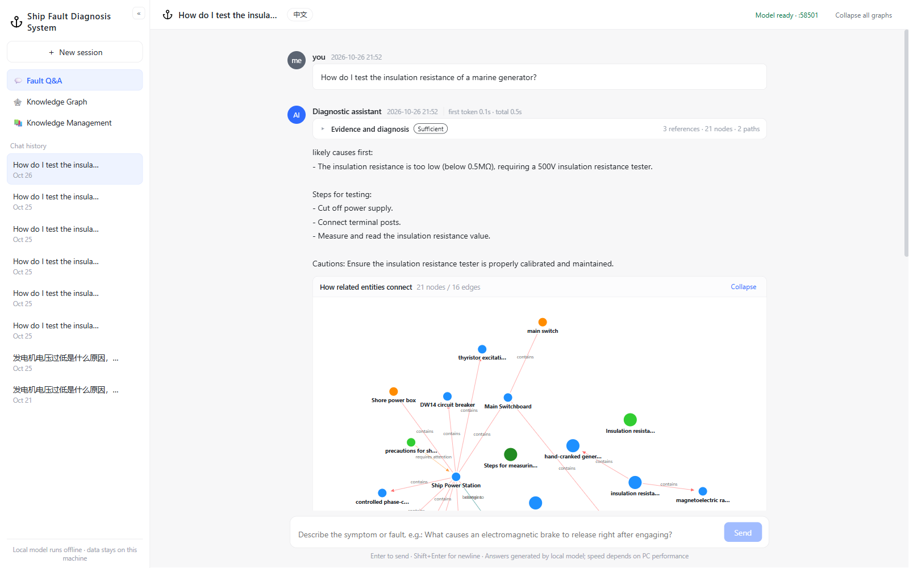
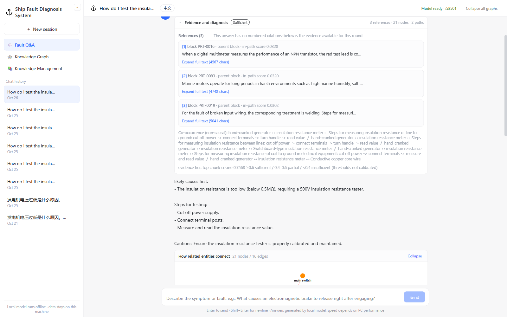
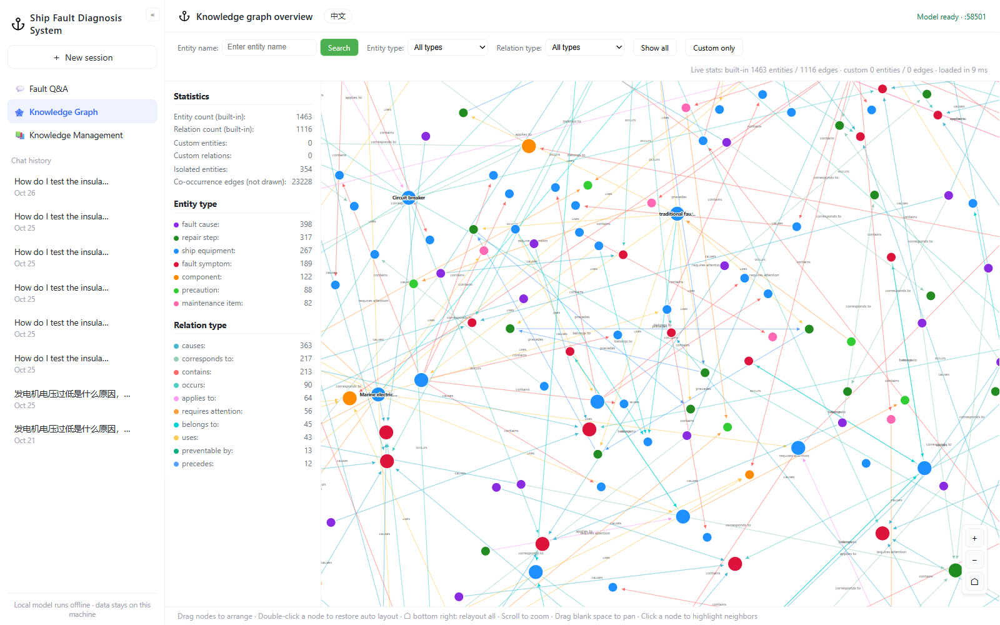

# Ship Fault Diagnosis System (船舶故障诊断系统)

**An offline, knowledge-graph-augmented RAG question-answering system for marine electrical equipment fault diagnosis.**

Version 0.5.1 · archived at Zenodo: [10.5281/zenodo.24198739](https://doi.org/10.5281/zenodo.24198739)

The system answers natural-language questions about ship electrical equipment maintenance and fault diagnosis by fusing **two retrieval pathways** — text and knowledge graph — and grounding every claim in cited evidence. It runs **fully offline** on consumer hardware (local embedding / reranking / generation via llama.cpp).

> The knowledge corpus and knowledge graph are **rebuilt from the ground up** for this project: a marine-electrical corpus is authored by human curation together with large language models, and entities and relations are extracted from that corpus. No copyrighted third-party text is redistributed.

**Start here:** [QUICKSTART.md](QUICKSTART.md) (download, run, first question) · [USER_GUIDE.md](USER_GUIDE.md) (page-by-page usage) · [DEPOSIT.md](DEPOSIT.md) (models, databases, checksums) · [experiment/](experiment/) (evaluation questions and answers) · [CONTRIBUTING.md](CONTRIBUTING.md) (development setup and conventions).

---

## Table of contents

- [Key features](#key-features)
- [Architecture](#architecture)
- [Repository layout](#repository-layout)
- [Requirements](#requirements)
- [Getting started](#getting-started)
- [Build from source](#build-from-source)
- [Run the smoke tests](#run-the-smoke-tests)
- [Data assets](#data-assets)
- [Experiment and reproducibility](#experiment-and-reproducibility)
- [Third-party components and licenses](#third-party-components-and-licenses)
- [License](#license)

---

## Key features

- **Two-path retrieval fusion** — each path runs independently and is measured separately:
  - **Text path** — lexical (FTS via jieba + trigram) + dense vector similarity over text chunks, with optional reranking.
  - **Graph path** — entity-vector seeding, causal path search over `导致 / 对应` relations, plus a *co-occurrence* association layer (explicitly marked non-causal), producing local subgraphs and diagnostic paths.
- **Causal / diagnostic tree** — a deterministic, profile-aware tree builder (`fault` / `maint` / `oper`) that turns the retrieved evidence bundle into a "what to check first" diagnostic tree.
- **Evidence-grounded generation** — a six-segment prompt with numbered citations; the model must answer only from the provided material and say "insufficient data" otherwise.
- **User knowledge layer** — users can add their own texts / entities / triples, validated against a fixed ontology and merged read-only over the built-in knowledge base.
- **Fully offline** — embedding (Qwen3-Embedding-0.6B), reranking (Qwen3-Reranker-0.6B), and generation (Qwen3-0.6B) all run locally through llama.cpp (CUDA or CPU); the renderer never talks to model ports directly.
- **English interface** — a language switch (`EN` / `中文`) in the header; see below.

## English interface

The UI ships with a language switch (`EN` / `中文`, top-right of the header). In English mode:

- interface labels, error messages and dialogs are English;
- retrieval runs an English lexical path (`chunks_fts_en`, trigram over translated chunk text) fused with the multilingual embedding path;
- evidence blocks are shown from the translated layer (`chunks.text_en`), with the Chinese original kept in the database;
- the knowledge-graph overview shows English entity names, entity types and relation labels (`entities.name_en`, `labels_en`);
- answers are generated in English from the same evidence bundle.

> All reported evaluation numbers refer to the **Chinese** pipeline; the English layer is a translated view added on top of it (see `experiment/`). Chinese mode keeps the original behaviour.

The English layer is a build-time product: a frozen translation of the corpus and graph lives in `workspace/data/chunk/chunks_en.jsonl`, `workspace/data/graph/entities_en.csv` and `labels_en.csv`. Rebuilding it from scratch requires a commercial translation API and is therefore not part of the public build.

### Screenshots (English mode)







## Architecture

```
query/
  text-retrieval/        # lexical + vector text search (FTS, rerank)
  graph-retrieval/       # entity seeding, causal paths, co-occurrence, subgraph
  answer-generation/     # embedding, rerank, answer orchestration
  evidence-prompt/       # six-segment prompt assembly with citations
  shared/                # build-tree (diagnostic tree), dial, locale, shared types
  qa-core/               # orchestration, sessions, user knowledge base
  launcher/              # path resolution, process management, diagnostics
  config/                # retrieval / evidence / model / prompt configuration
  frontend/              # Electron + React UI, smoke-test scripts
build/                   # corpus / graph / index build pipeline (Python)
data/                    # knowledge assets: corpus, chunks, graph, vectors, runtime
environment/             # download placeholders for the bundled runtimes and model weights
```

The retrieval pipeline reads two SQLite stores under `data/vector-index/`:
`chunk.sqlite` (text chunks + FTS + vectors) and `graph.sqlite` (entities, triples, `chunk_entities`, entity/triple vectors, and co-occurrence edges).

## Repository layout

| Path | Description |
|------|-------------|
| `workspace/query/` | Application source (TypeScript) |
| `workspace/build/` | Corpus / graph / index build scripts (Python) |
| `workspace/data/` | Knowledge assets: corpus, chunks, graph, English layer, manifests |
| `workspace/environment/` | Download placeholders (versions, URLs, checksums) for bundled runtimes and models |
| `experiment/` | Evaluation questions and the four-pipeline answers used in the paper |
| `docs/` | Screenshots and figures |
| `DEPOSIT.md` | What is not in the repository, where to get it, how to verify it |

Model weights, the two SQLite stores and the Electron runtime are **not** tracked: they are large
binary payloads. `DEPOSIT.md` lists them with download URLs and sha256 checksums.

## Requirements

Everything needed is downloaded into `workspace/environment/` — no global install required:

| Component | Version | Purpose |
|-----------|---------|---------|
| Python | 3.12.4 (+ jieba 0.42.1) | Build pipeline, FTS pre-segmentation |
| Node.js | 24.21.0 | Build / smoke-test tooling (native type stripping) |
| Electron | 44.4.5 | Desktop application shell |
| llama.cpp | b11205 (CUDA + CPU) | Local embedding / reranking / generation |
| Qwen3-Embedding-0.6B-Q8_0 | — | 1024-dim text & entity embeddings |
| Qwen3-Reranker-0.6B-Q8_0 | — | Passage reranking |
| Qwen3-0.6B-Q8_0 | — | Answer generation |

A NVIDIA GPU with CUDA is optional; the app falls back to CPU mode automatically (slower).

## Getting started

For the end-user path (download the release archive, run, ask a question), see [QUICKSTART.md](QUICKSTART.md).

From a source checkout you need the payloads from [DEPOSIT.md](DEPOSIT.md) first:

```powershell
# after placing runtimes/models under workspace/environment/ and building:
cd workspace/query/frontend
npm run build
npm run assemble
npm run app          # build, assemble and launch
```

> **Note (Windows):** when launching from an Electron-hosted shell, unset `ELECTRON_RUN_AS_NODE` first; otherwise the bundled Electron is executed in Node mode and exits with `bad option`. Double-clicking in Explorer is unaffected.

## Build from source

```powershell
cd workspace/query/frontend
npm run build          # tsc -b && vite build
npm run assemble       # assemble the app into bin/
npm run build:launcher # (re)build the one-click launcher
```

The structural freeze can be verified at any time:

```powershell
pwsh -File workspace/verify-layout.ps1
pwsh -File workspace/query/verify-structure.ps1
```

Both must print `OK` and exit `0`.

## Run the smoke tests

The smoke tests are self-contained: they start a temporary embedding (and reranking) service, exercise the pipeline against `data/`, print measured latencies, and tear everything down.

```powershell
cd workspace/query/frontend
npm run smoke:3way      # all enabled retrieval paths (text + graph)
npm run smoke:text       # text path only
npm run smoke:graph      # graph path only
npm run smoke:retrieval  # embedding / reranker sanity
node scripts/smoke-user-kb.cjs   # user knowledge-base layer (24 checks)
```

UI-level chat verification (requires the app running with a CDP port):

```powershell
node scripts/verify-chat.cjs 9222 ./verify-chat.json
node scripts/cdp-probe.cjs 9222 --close
```

A successful run prints `RESULT OK` (all paths) or `RESULT OK (24 items PASS)` (user KB).

## Data assets

The shipped knowledge assets live in `workspace/data/`:

> **Git scope:** the repository tracks source, configuration, manifests, the corpus, the chunk/graph build inputs and the English layer. The large SQLite stores, the model weights and runtime binaries are intentionally **not** tracked — see [DEPOSIT.md](DEPOSIT.md).

| Asset | Scale |
|-------|-------|
| Text chunks | 1,332 (1,065 text / 267 parent), 0 table |
| Entities | 1,463 |
| Triples | 1,116 (11 relation types) |
| Co-occurrence edges | 15,988 |
| Chunk / entity / triple vectors | 3,644 (1,065 / 2,579), 1024-dim |

Quality gates enforced by the build pipeline: chunk numbering is gap-free, every entity/triple `chunk_ids` reference resolves to an existing chunk, `chunk_entities` has no dangling references, and the corpus carries **no copyright identifiers** (title / author / publisher / ISBN / price / edition all verified absent).

## Experiment and reproducibility

The four-arm experiment (`ours` / `no_graph` / `naiverag` / `lightrag`), the frozen 50-question set
and the 400 answers live under `experiment/`. Published there: the question set (design fields only)
and the four-pipeline answers. Withheld: gold scoring annotations, LLM-judge verdicts, human-review
records and all scores — these are reported in the paper and available from the corresponding author
upon reasonable request. See `experiment/README.md`.

## Third-party components and licenses

This repository relies on the following third-party components (they are **not** covered by this project's license):

| Component | License | How it is used |
|-----------|---------|----------------|
| Electron | MIT | desktop shell (downloaded, not vendored) |
| llama.cpp | MIT | local inference (downloaded, not vendored) |
| Qwen3 models (embedding / reranker / answer) | Apache-2.0 | model weights (downloaded, not vendored) |
| jieba | MIT | Chinese word segmentation |
| Node.js | MIT | build tooling |
| Python (CPython) | PSF-2.0 | build pipeline |
| LightRAG (lightrag-hku 1.5.7) | MIT | evaluation baseline only, installed from PyPI — not vendored; see `experiment/README.md` |
| d3 7.8.5 | ISC | graph visualisation, vendored under `workspace/query/frontend/public/vendor/` (required for offline use) |

## License

Code and data are licensed under the **Apache License, Version 2.0** — see the [LICENSE](LICENSE) file in the project root.

```
Copyright 2026 The Ship Fault Diagnosis System Authors
```
